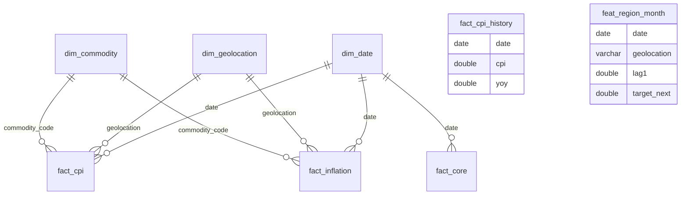

# Price Signals: Philippine CPI Analytics

Public web app for PSA OpenSTAT consumer-price data: a 3D Philippines map drives
every panel. Built for the MIT 118 group project (Saint Louis University, Baguio City).

**Stack:** FastAPI · DuckDB over Parquet · vanilla ES modules · three.js (map) · Plotly.js (charts).

## Quick start

```bash
python -m pip install -r requirements.txt
uvicorn app.main:app --reload --port 7860
```

Open <http://localhost:7860>. The committed warehouse and model artifacts make the
app start without a build step.

## Tests

```bash
python -m pytest -q tests     # API contract, <1,000-row guard, pipeline rebuild, nowcast, story
python tests/test_geo.py      # polygon <-> warehouse crosswalk (run once)
```

## Architecture

```
Browser (ES modules, no bundler)
  ├─ store.js        single state: region, date range, focusDate, metric, sector
  ├─ map3d.js        three.js extruded choropleth, raycast pick, keyboard select
  ├─ api.js          abortable fetches, dedupe cache, CSV exports
  └─ panels/*        overview · forecast · drivers · risk · structure · data

FastAPI
  ├─ routers/meta.py       /api/health · /api/meta · /api/sql/{panel} · /api/export
  ├─ routers/panels.py     KPIs, map, series, drivers, calendar, distribution, table
  ├─ routers/forecast.py   forecast (POST), classifier, SHAP, residuals, metrics
  ├─ services/forecast.py  SARIMA + ETS, basket-weight shock, LRU cache
  └─ db.py                 DuckDB views + guarded queries (<1,000 rows)
```

## Data model



Facts are partitioned Parquet (`data/warehouse/fact_*/*/*.parquet`); dimensions are
single files. `feat_region_month` is the model-ready derivative.

## Region crosswalk

`data/geo/geo_key_map.csv` maps all 18 warehouse regions to exactly one GeoJSON
polygon (`scripts/build_geo.py`). No aggregate rows are mapped; every mapped region
is reachable from the map, combobox and ranked list.

## Reproducibility

Raw PSA OpenSTAT extracts are not stored in this repository, so the pipeline starts
from the committed Parquet warehouse (`data/warehouse`, vintage 2026-11-05):

```bash
python -m pipeline.build_features --check   # DuckDB window-SQL rebuild of feat_region_month, diffed against the committed file
python -m models.train_models               # rolling-origin evaluation + artifacts in data/models (needs shap, offline only)
```

`train_models` evaluates every model against a **persistence baseline** (this month carried
forward) in four rolling windows, writes `metrics.json`, `nowcast_test/latest.parquet`, SHAP,
ROC/PR curves and honest interval coverage. The app only reads these artifacts and refits
SARIMA/ETS live; the regional what-if re-trains a small model at start-up (about 1 s).

### Refreshing the data from OpenSTAT

The app never contacts OpenSTAT. To load a newer PSA release, download the tables from
<https://openstat.psa.gov.ph> as "Comma delimited with heading" CSV (CPI and core CPI, 2018=100,
plus the matching inflation-rate tables), then:

```bash
python -m pipeline.ingest_openstat --cpi exports/cpi.csv --core exports/core.csv \
    --inflation exports/inflation.csv --core-inflation exports/core_inflation.csv --check   # compare only
python -m pipeline.ingest_openstat --cpi exports/cpi.csv --core exports/core.csv \
    --inflation exports/inflation.csv --core-inflation exports/core_inflation.csv           # write data/warehouse
python -m pipeline.build_features && python -m models.train_models
```

Each flag can be repeated when a table is split across several downloads. Leaving out
`--inflation` or `--core-inflation` computes those rates from the index (rounded to 1 decimal,
so they can differ from PSA's published rate by 0.1). Areas and commodities must already exist in
`dim_geolocation` / `dim_commodity`; the script stops and names any it does not recognise.
Finally set `data_vintage` in `app/config.py` to the export date.

## Rubric map

| Requirement | Where |
|---|---|
| ETL / DuckDB SQL, <1,000 rows per visual | `app/sql/*.sql`, `pipeline/build_features.py`, `app/db.py` guard |
| Basic + advanced visuals | Trends, drivers, 3D map, heatmap, calendar, PCA, SHAP, treemap |
| Predictive visual with uncertainty | "What happens next": SARIMA/ETS fan chart (80% / 95%) |
| Scenario engine changing model inputs | Price-shock presets, SARIMA/ETS hyperparameters, regional what-if (`/api/nowcast/whatif`) |
| Cross-filtering | Map / ranking / story chart pick a region; clicking a high-error dot in "Risk by region" filters region + month everywhere and opens its SHAP explanation |
| Dynamic horizon / parameters | 6-36 month slider, model order controls |
| Non-technical storytelling | "The story" tab: six chapters written from live data, plain-word guide |

## Deploy (Docker, HF Spaces / Render)

```bash
docker build -t price-signals .
docker run -p 7860:7860 price-signals
```

Hugging Face Spaces (Docker SDK): push this folder, port 7860.
Render: create a Web Service from the Dockerfile. Note the free-tier memory/limit
risks in `specs.md` §14.

## Honesty notes

- For the regional next-month nowcast, "same as this month" beat the boosted-trees model in every test window; the dashboard says so and shows both.
- Regional guess ranges are empirical and under-cover during the 2026 surge (see Data and method).
- Free-tier hosts sleep: open the live link a few minutes before a demo.
- Forecasts are decision-support estimates, not official PSA/BSP projections.
- Missing months are absent, never imputed; outliers are flagged, not removed.
- Fold-level accuracy is shown separately; a blended number would hide the 2026 regime shift.
- The price shock uses the 2018 basket-weight approximation and is labeled as such.
