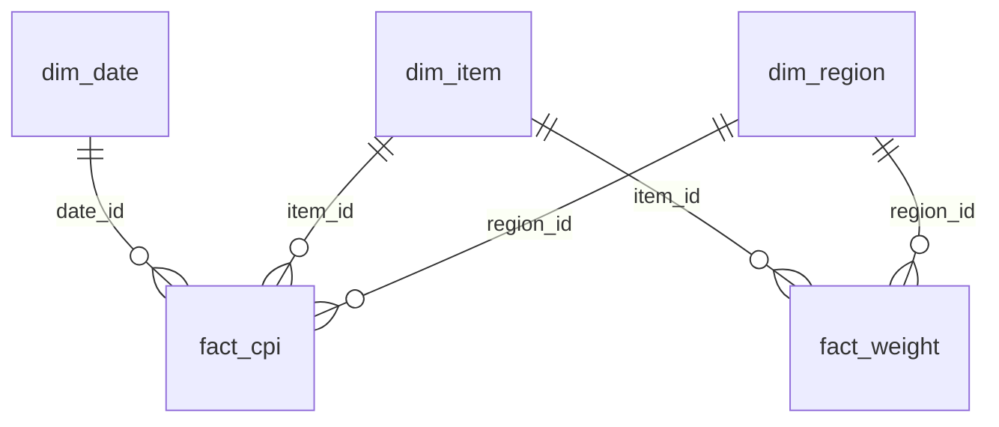
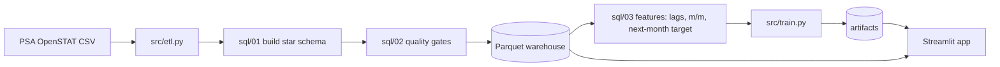

# BantayPresyo

Interactive dashboard that tells Filipinos, in plain language, **whether prices are rising too fast, where, why, and what happens next**, built on PSA OpenSTAT consumer-price data.
MIT 118 final group project (Data Visualization & Visual Analytics) · Jhaynher Felix · David Justine Javillonar · Melbert Marafo.

Stack: **Streamlit + DuckDB (SQL) + Plotly**, statsmodels (SARIMA/ETS), scikit-learn (gradient boosting), SHAP.

## Run it
```bash
python3 -m venv .venv && source .venv/bin/activate
pip install -r requirements-dev.txt   # app + SHAP/pytest, for retraining and tests
python -m src.etl      # CSV exports -> Parquet star schema (+ 8 data-quality gates)
python -m src.train    # forecasts, models, SHAP, PCA, backtests -> data/artifacts/
streamlit run app.py   # http://localhost:8501
pytest -q              # 6 tests
```
The repo already contains the built `data/warehouse/` and `data/artifacts/`, so `streamlit run app.py` works straight after install.

## Deploy (Streamlit Community Cloud)
Push to GitHub → share.streamlit.io → *New app* → repo, branch `main`, main file `app.py` → Deploy. Python 3.11 or 3.12.

## Data
Five CSV exports from PSA OpenSTAT (`data/raw/`): CPI by commodity group 2018–2025 and Jan–Oct 2026, year-on-year change (two files), 2018-based weights.
19 geographies (national + 18 regions) × 14 commodity groups × 106 months → **28,196 CPI rows**. File names in exports can be misleading (two files are swapped), so the ETL identifies each file by its title line and columns.




## Where each requirement lives
| Brief requirement | Where |
|---|---|
| Gov't open data, ≥1,000 records, documented ETL, DuckDB SQL | `src/etl.py`, `sql/01–03`, Data & SQL page (ER, pipeline, 8 live quality checks) |
| <1,000 rows to any visual | `common.q()` asserts it on every query |
| ≥5 basic visuals | Explore › Basic: line+trend, ranked bar, basket-weight bar, histogram+stats, scatter+r |
| ≥5 advanced visuals | Explore › Advanced: heatmap, treemap, waterfall, correlation matrix, slope chart; Risk: beeswarm, waterfall, PDP/ICE |
| Predictive visuals, fan charts 80/95% | Forecast Lab (SARIMA/ETS), Risk, Where it misses |
| XAI (SHAP / PDP) | Risk › section 2 (global, beeswarm, local waterfall, PDP+ICE) |
| Decision-boundary projection (PCA) | Risk › section 3 (model projected, or k-NN with k slider; misclassified marked) |
| Interactive ROC / PR / Lift + threshold and business-cost sliders | Risk › section 1 |
| Global filters, cross-filtering | Sidebar region + period on every page; click/lasso a miss on *Where it misses* re-filters 3 views and a table |
| Metric cards, expandable SQL previews, latency | KPI cards on every page; "SQL ·" expander under each chart; sidebar latency + query log |
| What-if / scenario engine | Price Check what-if; Forecast Lab price shock + order/horizon/origin; Risk › section 4 (feature shocks + model hyperparameters) |
| Dynamic horizon, k, confidence, smoothing | Forecast Lab sliders (horizon, band, smoothing k, p/d/q); Risk (cutoff, costs, k-NN k) |
| Uncertainty encoding | Fan chart bands, ± typical-miss bars, calibrated "chance above 4%" |
| Colour-blind safe | Okabe-Ito categorical, Cividis sequential, blue↔vermilion diverging; no red/green meaning |
| Tests / CI | `tests/`, `.github/workflows/ci.yml` |

## Results (honest)
Out-of-sample = months after Jun 2025 (270 region-months, 52% above the 4% ceiling).

| | Model | Carry this month forward |
|---|---|---|
| Regional next-month MAE (pts) | 0.84 | **0.80** |
| Above-4% call accuracy | **93.3%** | 92.6% |
| Breach AUC / AP | 0.978 / 0.985 | – |
| National 1–12 mo MAE (pts, 4 origins) | SARIMA 1.83 · ETS 2.77 | **1.66** |

Inflation is highly persistent, so "same as now" is a hard baseline. The models earn their place through **calibrated risk, explanations and what-ifs**, not a lower average error. SARIMA's 80% band caught 71% of real outcomes (ETS 64%), so bands are somewhat narrow, so read them as a floor on uncertainty.

## Limitations
Group-level (14 groups) data, not individual products; price what-if is a first-order basket-weight approximation; 106 months is short for seasonal models; regions are not modelled spatially.

## Paper and defense
- `docs/BantayPresyo_IEEE_Paper.docx` (+ `.pdf`): 6-page IEEE technical paper with the four required sections. Insert the live-app and GitHub URLs (highlighted on page 1).
- Rebuild after changing data or models: `pip install matplotlib python-docx` then `python docs/paper/make_figures.py && python docs/paper/build_paper.py` (figures and every number in the paper are regenerated from the warehouse and artifacts).
- `docs/DEFENSE.md`: 10-minute defense script.
